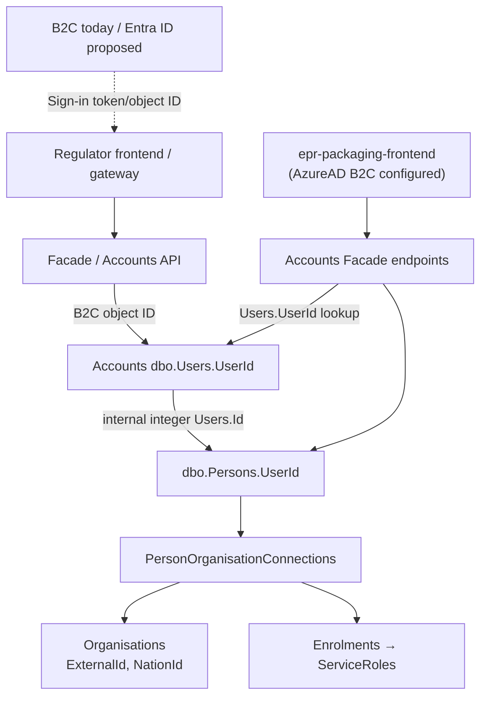
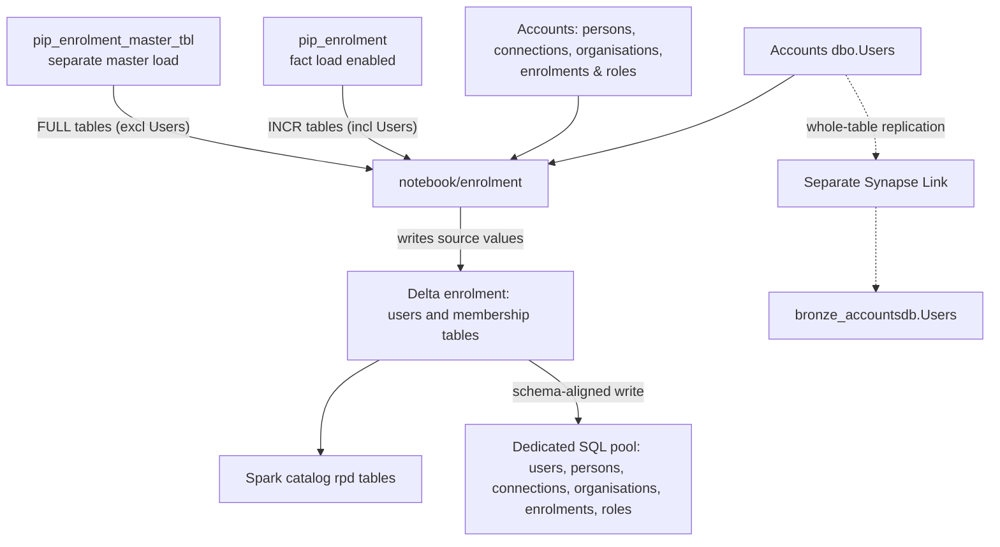
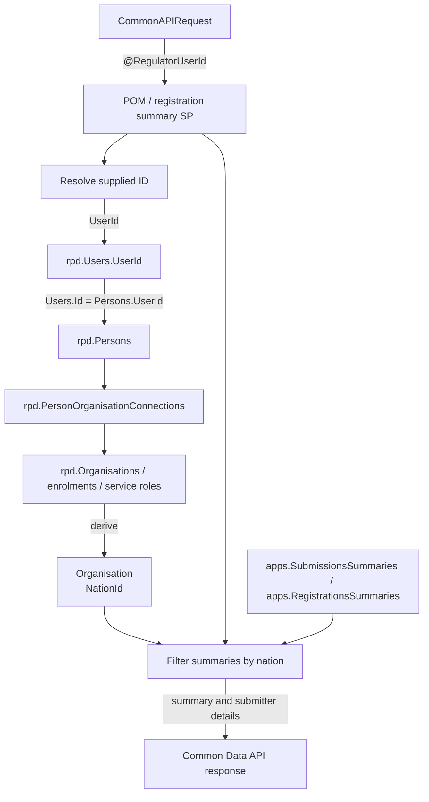
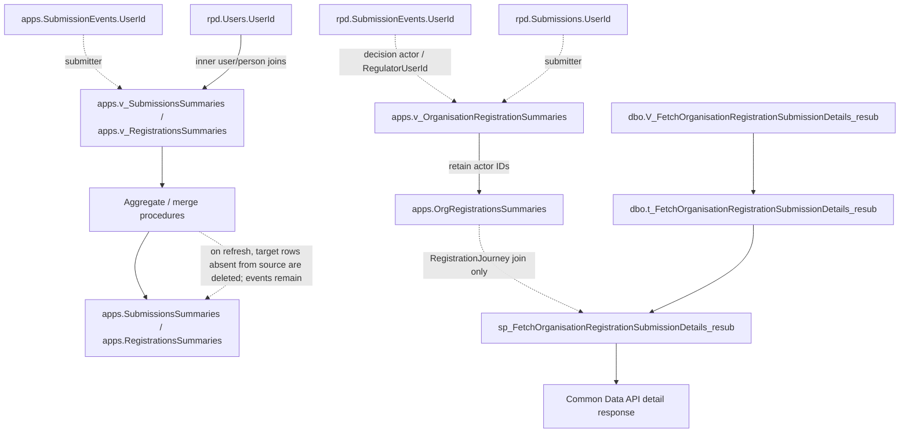
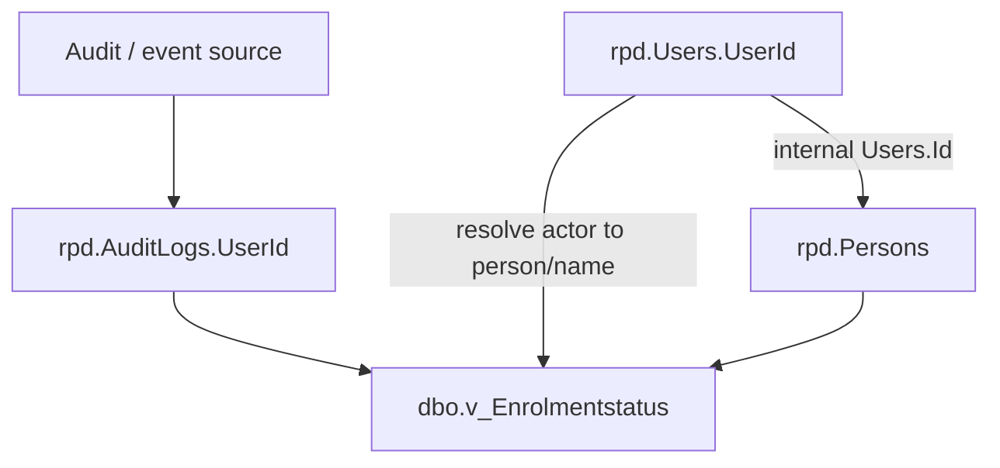
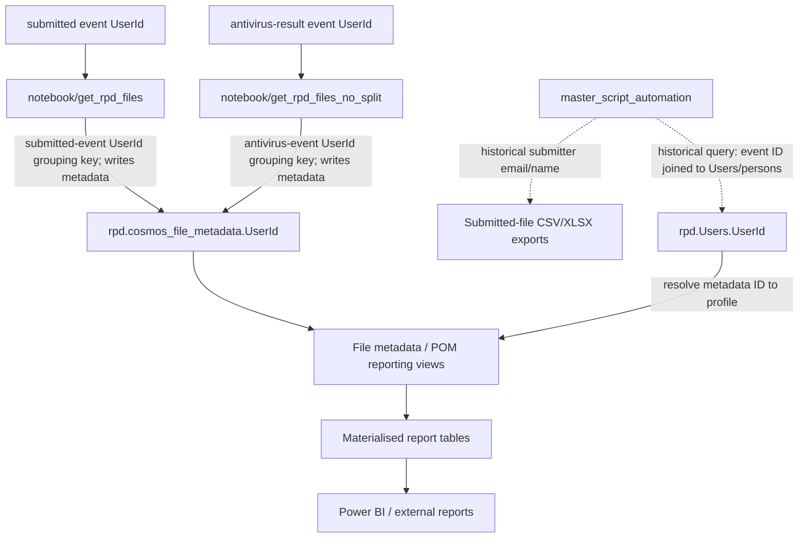

# Regulator B2C-to-Entra ID: Synapse lineage and change impact

## Purpose and conclusion

This document identifies checked-in Synapse and API objects that store, copy, join, filter, or expose the identifier currently represented by `rpd.Users.UserId`, and explains what may need to change when regulator sign-in moves from B2C to Entra ID.

**A provider switch does not, by itself, require a Synapse schema change.** If the regulator application continues to send the identifier Accounts already recognises (for example, through a verified Entra-to-existing-ID mapping), the existing `Users.UserId` flow can remain. If it sends a different Entra ID that is loaded into `rpd.Users.UserId`, the existing equality lookup can match it; verify identity binding and authorization, and address any event/profile joins that need to resolve historic IDs. Do not update event and audit history just because the current sign-in identifier changes.

This is a static review of checked-in repositories and the supplied test-environment extract. It does not confirm deployed SQL, live pipeline/link state, production identity claims, or runtime consumers. “Change” below means a code, schema, or data operation may be required under the stated identity design; it is not a recommendation to edit every listed object.

## Data lineage diagrams

The lineage is split into focused diagrams so each flow is easier to read and zoom independently. Read them in order: sign-in and Accounts, Accounts ingestion, the regulator caller lookup, historical submission and audit resolution, then notebook/report outputs. Repeated nodes such as `Accounts dbo.Users.UserId` and `rpd.Users.UserId` are the shared points between diagrams.

### 1. Sign-in identity and Accounts relationships

### 2. Accounts ingestion into Synapse

### 3. Regulator caller lookup and nation scope

### 4. Historical submission actors and summary materialisation

### 5. Audit and enrolment-history attribution

### 6. Notebook exports and reporting outputs

**Diagram conventions:** all diagrams flow top-to-bottom. Solid edges represent relationships supported by checked-in definitions or reviewed code paths; dotted edges indicate configured but runtime-unverified or otherwise unconfirmed paths. `UserId` fields in events, submissions, audit logs, and file metadata are separately stored actor/submitter values; their names do not prove that each has the same meaning as `rpd.Users.UserId`.

In diagram 4, `apps.SubmissionEvents` and `rpd.SubmissionEvents` are shown as separate sources because the checked-in summary views use different schema objects; the diagram does not assume a direct copy between them.

## Which objects may need to change

### Identity boundary and Accounts source

| Object / field | Current role | Migration impact |
|---|---|---|
| Regulator sign-in frontend/gateway and Accounts client | The regulator-specific sign-in-to-Accounts path was not available in the checked-in sources reviewed here; a generic account lookup does not prove which claim is supplied by a regulator. | **Verify before selecting an identity strategy.** Confirm issuer, tenant, audience, claim mapping and trusted binding from authenticated principal to lookup ID. Either translate the verified Entra identity to the existing Accounts ID or make the new identity resolvable. A successful login alone does not establish an Accounts match. |
| Accounts `dbo.Users.UserId`; `epr-data-sqldb\rpd\Tables\Users.sql:1-12`; backend lookup `epr-backend-account-microservice\src\BackendAccountService.Core\Services\UserService.cs:46-64` | Stores the external ID matched by the checked-in `user-accounts` Facade-to-backend route. `Users.Id` is a separate internal integer. | **Data change only if the chosen identity design requires it.** Decide whether this retains the old ID, is replaced, or supports a separate crosswalk/alias. Do not assume changing this one value preserves history. This does not establish deployed routing or mappings for other endpoints. |
| Accounts `Persons.UserId`, `PersonOrganisationConnections`, `Organisations`, `Enrolments`, `ServiceRoles`; pool key relationship in `epr-data-sqldb\rpd\Tables\Persons.sql:1-14` | Connects internal `Users.Id` to a person, organisation, nation and service role. | Usually **no schema change** for a pure ID translation if these stable internal relationships remain correct. If adding a parallel account, its person and membership/enrolment must be created through the supported Accounts process and reviewed for correct access. Do not create a Synapse-only user row. |

### Synapse ingestion and current-account tables

| Object | Current role | Migration impact |
|---|---|---|
| `epr-data-ado\notebook\enrolment.json:363-389,434-528,633-652` | Reads configured Accounts tables, writes Delta, exposes Spark `rpd` tables and writes to the dedicated pool. The notebook copies the source `Users.UserId`; it does not mint a sign-in ID. | **No code change solely for a changed value in an existing column.** Confirm deployed `ctrl_table.csv` includes `Users` and related tables and run/reconcile the relevant load. If introducing a new crosswalk/alias column or table, adapt source selection, Delta handling, Spark/SQL target schema and load configuration. |
| `trigger\trg_tumb_rpd_apps_wd.json:5-16`; `pipeline\pip_rpd_main_wd.json:5-15,43-44,71-90`, `pip_wrapper.json:5-19`, `pip_enrolment.json:5-30`, `trigger\trg_enrolment_master_tbl.json:5-20`, `pipeline\pip_enrolment_master_tbl.json:18-30` | Checked-in scheduled branches: wrapper runs only on the UTC-hour true branch after preceding activity succeeds; the enrolment pipeline enables fact loading, while a separate master pipeline loads master tables. The notebook chooses configured `INCR` tables plus `Users` versus `FULL` tables excluding `Users`. | Normally **no definition change** for an ID value change. These are configuration paths, not proof of deployed control-file contents, successful runs, or data freshness. Verify the actual trigger/run, table list, watermarks and propagation before downstream refreshes. |
| Delta `Users` and related enrolment tables; dedicated pool `rpd.Users` and membership tables | Current copies of Accounts records. `rpd.Users.UserId` is the external ID; `rpd.Persons.UserId` points to internal `rpd.Users.Id`. | **Values must reconcile after cutover.** Existing columns can carry a replacement GUID without schema changes. A crosswalk design requires explicit Delta/pool schema and ingestion support. Compare IDs and relationships, not just row counts. |
| `epr-data-pipelines\linkConnections\config\accountsLinkConnectionTables.json:208-210` → `bronze_accountsdb.Users` | Separately configured replication of the whole `dbo.Users` table, with no column list or regulator filter. The README says a created link remains stopped until manually started (`linkConnections\README.md:91-95`). | **No indicated change for `UserId` value alone.** If the crosswalk is added, verify the linked target supports it. The configuration is not proof the link is started or connected to `rpd.Users`; do not treat it as the notebook’s source without deployment evidence. |

### Caller-to-nation SQL procedures

The following procedures resolve the supplied `@RegulatorUserId` through `rpd.Users.UserId`, follow the internal person/organisation/enrolment chain, require `ServiceRoles.ServiceId = 2`, and filter returned summaries by the resolved organisation nation. Whether the supplied ID is bound to the authenticated caller is not established by the checked-in API path. The procedures do not use an `OrganisationTypes.Name = 'Regulators'` filter.

The reviewed lookup has no explicit deleted/status predicate. If no qualifying user/membership is found, the nation remains unset and the equality filter returns no summaries; multiple qualifying memberships have no explicit deterministic handling. These are static SQL behaviors, not evidence that missing or ambiguous identities occur in production.

| Object | What it does | Migration impact |
|---|---|---|
| `epr-data-sqldb\apps\Stored Procedures\sp_FilterAndPaginateSubmissionsSummaries.sql:2-6,16-53,104-138` | Matches `@RegulatorUserId` to `rpd.Users.UserId` and derives nation. | **Change or compatibility logic is conditional.** If the new GUID is loaded into `rpd.Users.UserId` and the same GUID is supplied, the equality lookup can match it. Otherwise retain/translate the old ID or implement a verified mapping. Test ambiguous matches and absent/inactive memberships. |
| `epr-data-sqldb\apps\Stored Procedures\sp_FilterAndPaginateSubmissionsSummaries_resub.sql:2-6,16-56,108-142` | Same caller-to-nation resolution for resubmission summaries. | Same conditional change as above. |
| `epr-data-sqldb\apps\Stored Procedures\sp_FilterAndPaginateRegistrationsSummaries.sql:2-6,15-52,100-146` | Same caller-to-nation resolution for registration summaries. | Same conditional change as above. |
| `epr-common-data-api\src\EPR.CommonDataService.Core\Models\Requests\PomSubmissionsSummariesRequest.cs:6-10`, `...\Extensions\StoredProcedureExtensions.cs:66-78`, `...\Services\SubmissionsService.cs:23-47`, `epr-common-data-api\src\EPR.CommonDataService.Api\Controllers\SubmissionsController.cs:22-45` | Carries request-supplied `Guid UserId`, maps it to `@RegulatorUserId`, calls summary procedures and returns submitter details. | **Review trusted identity binding end to end.** The checked-in API forwards the supplied GUID; these sources do not establish that it is bound to the authenticated caller. SQL must resolve the ID and the deployed authorization path must be verified. The organisation-registration detail API is not the regulator caller lookup. |
| `epr-data-sqldb\dbo\Stored Procedures\sp_FilterAndPaginateOrganisationRegistrationSummaries.sql:2-10,54-81` and `sp_FilterAndPaginateOrganisationRegistrationSummaries_resub.sql:49-60`; `epr-common-data-api\src\EPR.CommonDataService.Api\Controllers\SubmissionsController.cs:117-128` | These procedures filter by supplied `NationId`; they do not perform the `@RegulatorUserId` lookup. The `_resub` procedure also allows an application-reference match from another nation; both SQL variants allow `NationId = 0`, while the reviewed API rejects zero. | Not a direct caller-ID migration point. Verify intended authorization, API/deployed version and reference exception; this static SQL finding is not proof of an exploitable deployed path. |

### Event, audit, view and materialised-table lineage

These are separate IDs written by submission, audit, or file-processing paths. Updating `rpd.Users.UserId` does **not** rewrite them. The proper action is to retain their existing resolution, add a deliberate alias/crosswalk where needed, or perform a separately approved historical data migration.

| Object family | Relevant objects | Migration impact |
|---|---|---|
| Stored actor/submitter IDs | `epr-data-sqldb\rpd\Tables\SubmissionEvents.sql:1-54` (`UserId`, `RegulatorUserId`); `rpd\Tables\Submissions.sql:15-19`; `rpd\Tables\AuditLogs.sql:1-5`; `apps\Tables\SubmissionEvents.sql:28-35`; `apps\Tables\Submissions.sql:13-19`; file metadata tables `rpd\Tables\cosmos_file_metadata.sql:2-6` and `error_files_not_processed.sql:2-6`. | **Do not bulk-replace by default.** Establish which source writes each ID and whether it is historical, producer, regulator, or submitter identity. Keep old IDs resolvable for old events and audit history. |
| POM/registration summary enrichment | `epr-data-sqldb\apps\Views\v_SubmissionsSummaries.sql:35-49,269-337` → `apps\Tables\SubmissionsSummaries.sql:3-16`; `apps\Views\v_RegistrationsSummaries.sql:42-68,291-366` → `apps\Tables\RegistrationsSummaries.sql:19-26`; `apps\Stored Procedures\sp_AggregateAndMergePomData.sql:44-76,78-112,113-179`, `sp_AggregateAndMergeRegistrationData.sql:8-50,52-110,226-227`. | Views use inner joins from event IDs through `rpd.Users.UserId` and persons. An unresolved historical ID can remove a row from the view, not only lose profile enrichment. Refresh merges delete target rows absent from the source; a refresh can therefore remove materialised summary rows while underlying events remain. Preserve/adapt old-ID resolution and reconcile source/target row counts and keys before and after any refresh. |
| Organisation registration actors | `epr-data-sqldb\apps\Views\v_OrganisationRegistrationSummaries.sql:3-45,124-162,234-257,271-314` → `apps\Tables\OrgRegistrationsSummaries.sql:3-39`; `apps\Stored Procedures\sp_MergeSubmissionsSummaries.sql:313-359,375-388`; `dbo\Views\V_FetchOrganisationRegistrationSubmissionDetails_resub.sql:47-55,106-107,823-830` → `dbo\Tables\t_FetchOrganisationRegistrationSubmissionDetails_resub.sql:25-47`; `dbo\Stored Procedures\sp_FetchOrganisationRegistrationSubmissionDetails_resub.sql:27-48,65-72`. | `SubmittedUserId` comes from `rpd.Submissions.UserId`; `RegulatorUserId` is derived from decision-event `UserId` in `rpd.SubmissionEvents`, not the separate event column. These actor IDs are not all looked up in `rpd.Users`. The detail procedure reads actor IDs from the detail table; its summary-table join supplies `RegistrationJourney`. The detail view independently derives its actor IDs from events and user joins. Keep these lineages distinct and preserve old values for history. |
| Audit / enrolment-history resolution | `epr-data-sqldb\dbo\Views\v_Enrolmentstatus.sql:37-55`; `dbo\Views\v_enrolment_history.sql:12-21`; `dbo\Views\v_rpd_Users_Active.sql:1-4`; `dbo\Views\v_rpd_Persons_Active.sql:1-17`. | `v_Enrolmentstatus` matches audit `UserId` to `rpd.Users.UserId` for a historical actor name. Replacing the current ID without an alias can break this name resolution. The active wrappers filter records, not identity values. |
| File metadata and profile joins | `epr-data-sqldb\dbo\Views\v_cosmos_file_metadata.sql:1-40,63-84`, `v_cosmos_file_metadata_CS_additions.sql:28-51,56-76`, `v_Submitter_Name.sql:16-34`, `v_PersonOrganisationConnections.sql:77-96`, `v_POM_Submissions.sql:77-88`, `v_POM_Submissions_R8.sql:77-88`, `v_submitted_pom_org_file_status.sql:363-389,413-425`. | Some directly match metadata/event IDs to `rpd.Users.UserId`, others expose profile fields through internal IDs. **Check joins that must resolve existing metadata IDs** if `Users.UserId` is replaced; retain old IDs or add mapping as appropriate. |
| Other report/output objects | `epr-data-sqldb\dbo\Views\v_extract_recent_pom_org_data.sql:100-107,283-290`, `v_submission_count.sql:85-92,268-275`, `v_CompanyBrandPartnerFileUploadSet.sql:94-108`, `v_registration_with_brandandpartner.sql:198-219`; materialised `dbo\Tables\t_cosmos_file_metadata.sql:3-28`, `t_submitted_pom_org_file_status.sql:10-18`, `t_CompanyBrandPartnerFileUploadSet.sql:84-88`, `t_registration_with_brandandpartner.sql:240-265` and related report tables. | These may derive names/email/role or carry a file metadata ID. Review their upstream joins; refresh materialised outputs if a dependency changes. Human-readable report fields are not proof of stable identity continuity. |
| Legacy / export notebooks | Historical `master_script_automation` observation (not present in this checkout); `notebook\get_rpd_files.json:461-502,673-721`; `notebook\get_rpd_files_no_split.json:751-804,988-1017`. | The previously inspected master query selected submitter email/name through event-to-user/person joins, not the raw ID, but the notebook and pipeline are absent from this checkout and no generated export was inspected; treat as historical, unverified evidence. `get_rpd_files` groups on submitted-event `UserId` and writes file metadata; `get_rpd_files_no_split` groups on antivirus-result event `UserId` and writes metadata too. These distinct grouping keys do not establish equivalence or a `Users` join. |

## Change by identity approach

| Approach | Likely Synapse/API changes | Main caveat |
|---|---|---|
| **Keep legacy ID at the application boundary**: Entra sign-in is mapped to the existing Accounts identifier before calls that expect it. | Potentially none to Synapse schemas or SQL, provided the mapping is trusted, the API continues to send the expected value, and history joins remain valid. Change/test the regulator gateway’s identity mapping and sign-in configuration. | Define mapping authority and include issuer/tenant as well as subject; a GUID alone may not be globally unique. Verify actual token claims and account resolution. |
| **Add a parallel Entra account**: preserve B2C account and create a distinct Accounts user/person as needed. | Existing `Users.UserId` and notebook schemas can carry the new row. Load it and its person/organisation/enrolment links; adapt caller lookup only if duplicate or multi-membership matching is ambiguous. A new crosswalk field/table still needs ingestion and SQL handling. | This is not automatically the same person. Use supported provisioning, approve roles/membership, and test that a caller resolves to one intended nation. Preserve old event joins. |
| **Replace `Users.UserId` with Entra ID** | Update Accounts data and load to Delta/`rpd.Users`; caller lookup changes are needed only if the supplied ID does not match the loaded value or old-ID compatibility is required. Address every required historical event/audit/file-metadata resolution path via aliases/crosswalk or query changes. Refresh affected summary/report materialisations only after reconciliation. | Replacing only the current user row can disconnect old B2C event/audit IDs. Do not rewrite event history without a separate approved data-migration decision and complete dependency analysis. |
| **Add an identity crosswalk/alias** | Add and propagate the mapping table/fields through Accounts extraction, Delta and SQL; update caller and event/profile joins that need old↔new resolution. Add reconciliation/monitoring for missing and ambiguous aliases. | No such ready-to-use mapping was demonstrated in the supplied test extract; provider-specific fields were null there. Define uniqueness, lifecycle, tenant/issuer scope and ownership. |

## Validation and release checks

1. Capture the old and new sign-in token’s issuer, tenant, subject/object ID, audience and relevant name/role claims; prove which identifier is sent to Accounts and supplied in the Common Data API request, and verify that the request value is bound to the authenticated principal by the trusted authorization path.
2. Obtain an approved user mapping and population. Separate real active users from pending invitations, all-zero placeholder IDs, soft-deleted records, historical users, other-service memberships and duplicate old IDs. Do not infer identity from email or organisation name alone.
3. For each test regulator, verify one intended Accounts user/person/membership, regulator service enrolment and role, organisation and nation. Test users with several organisation memberships and repeated IDs; a successful login is not enough.
4. Run the deployed Accounts-to-Delta-to-pool load (and check Synapse Link separately if relevant). Reconcile `Users.UserId` and linked internal IDs/relationships across Accounts, Delta and `rpd`; compare keys and values, including deletions and mapping records, not only counts.
5. Test each caller summary procedure/API with the old ID and new ID according to the chosen design. Verify the expected nation and summaries, and verify an unknown, placeholder, deleted, or ambiguous identity fails safely rather than selecting unintended data.
6. Confirm historical names and attribution for audit, submission/decision events and file metadata, plus the master-script exports. Refresh dependent summary/report materialisations only after related source tables and identity mappings are consistent.
7. Rehearse cutover and rollback. Preserve old-ID resolution for historical dependencies until they are validated; record unresolved identities, propagation lag and failed joins as release blockers.

## Packaging frontend review

- `epr-packaging-frontend\src\FrontendSchemeRegistration.Application\Services\UserAccountService.cs:27-54,79-84` calls `user-accounts`, `persons?userId=...`, and `persons/all-persons?userId=...` (`Constants\UserAccountPaths.cs:5-7`). `AccountServiceApiClient.cs:28-61,64-100` sends delegated user tokens. The checked-in `user-accounts` route is traceable through the Facade to a backend lookup matching `person.User.UserId` (`epr-facade-account-microservice\src\FacadeAccountCreation\FacadeAccountCreation.API\Controllers\UsersController.cs:15-31`; `epr-backend-account-microservice\src\BackendAccountService.Core\Services\UserService.cs:46-64`). This establishes only the checked-in route, not deployed routing, mappings for the other `persons` endpoints, or regulator use.
- `RegulatorService.cs:22-29` calls `regulators/resubmission-notify/`; the reviewed method sends an email request and does not resolve the caller or invoke the regulator pagination procedures.
- `SubmissionService.cs:46-64` sends a `SubmittedBy` string through the Web API Gateway, whose `/api/v1/submissions/{id}/submit` endpoint is posted at `WebApiGatewayClient.cs:225-242`. Registration application and decision calls use other `/api/v1/...` routes (`:245-286`). The inspected methods do not send a `UserId` as `@RegulatorUserId` or invoke the caller-to-nation summary lookups listed above. The frontend does not show the gateway's database persistence mapping, so these calls do not establish use of `rpd.SubmissionEvents.UserId`, the `apps` event copies, or related summary tables/views. `SubmittedBy` must not be assumed to equal `rpd.Users.UserId`.
- `WebApiGatewayClient.cs:712-717` and `AccountServiceApiClient.cs:96-100` acquire delegated user access tokens. The checked-in `src\FrontendSchemeRegistration.UI\appsettings.json:2-10` configures `AzureADB2C` and a producers-account-facade scope; this does not establish that the frontend is used by regulators or that this app is in their sign-in path.
- No direct use of a database table, view, or stored procedure was confirmed in the reviewed frontend call paths. No new affected SQL object was identified, so the existing object inventories remain unchanged. Mappings for the other Accounts endpoints, Web API Gateway persistence, deployed routes, and runtime access by regulator accounts are not established by this static review.

## Evidence and limits

- The notebook path and object map are based on `epr-data-ado\notebook\enrolment.json`, the checked-in trigger/pipeline JSON, and the SQL/API definitions listed above. The notebook reads an external control file; the deployed file, run state, freshness and successful data propagation were not verified.
- The separate Synapse Link configuration includes the whole Accounts `dbo.Users` table in `bronze_accountsdb`, but the checked-in files do not establish that the link is running or that this bronze table feeds `rpd.Users`.
- No checked-in SQL predicate filtering `OrganisationTypes.Name = 'Regulators'` was found. The reviewed caller-scoping procedures use regulator service ID `2`; their `@OrganisationType` parameter is a result category filter. The caller lookup should still be checked for deployed deleted/status handling and ambiguous memberships.
- The reviewed definitions contain no confirmed Power BI dataset/report binding. Power BI and uninspected external consumers remain outside this static inventory.
- Detailed starting inventory: `docs\rpd-users-userid-lineage.md`. Key source references include `epr-data-sqldb\rpd\Tables\Users.sql`, `Persons.sql`, `apps\Stored Procedures\sp_FilterAndPaginateSubmissionsSummaries.sql`, `apps\Views\v_SubmissionsSummaries.sql`, `dbo\Views\v_Enrolmentstatus.sql`; `epr-common-data-api\src\EPR.CommonDataService.Api\Controllers\SubmissionsController.cs`; and the checked-in Facade and backend Accounts user lookup cited above. The previously cited regulator gateway files were unavailable in this checkout.