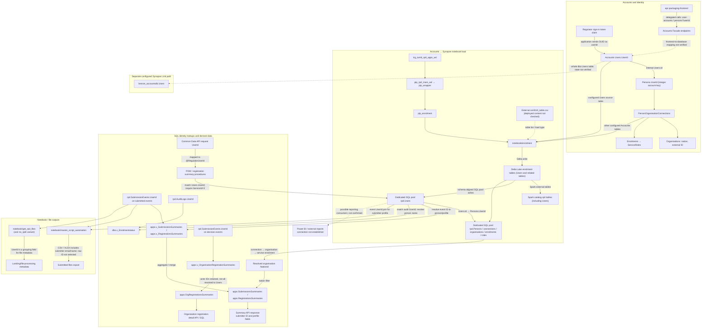

# `rpd.Users.UserId` data lineage

This document maps where the sign-in/user identifier in `rpd.Users.UserId` is copied, matched, retained as an event actor, or exposed by the checked-in Synapse and API definitions. It is a static repository trace, not proof of deployed objects, current pipeline state, or actual Power BI connections.

## End-to-end lineage

**How to read the diagram:** solid arrows show relationships present in checked-in code or definitions. Dotted arrows show a configured but runtime-unverified path or an unconfirmed consumer. `UserId` columns on events, submissions, audit, and file metadata are separately stored actor/submitter values; their names alone do not prove every value is the same kind of identity as `rpd.Users.UserId`.

## Key findings

- **The Synapse notebook copies the configured source value; it does not mint a new user ID.** `notebook/enrolment.json` reads its table list from the external `ctrl_table.csv` (`:363-367, 379-389`), forms a source `SELECT *` from configured schema/table (`:434-465`), writes Delta (`:472-496`), creates Spark-catalog `rpd.<table>` over that Delta location (`:491-496`), then writes to the dedicated pool (`:503-528, 633-652`). The checked-in control-file example in `epr-data-sqldb\Delta Lake Files\ctrl_table.csv` includes `Users`; the deployed file must be checked to confirm the live source/table and load type.
- **The scheduled notebook chain is represented in the workspace files.** `trigger/trg_tumb_rpd_apps_wd.json:5-16` points to `pipeline/pip_rpd_main_wd.json:5-14, 71-90`, which calls `pip_wrapper`; the wrapper calls `pip_enrolment` (`pipeline/pip_wrapper.json:5-19`) and that pipeline invokes the `enrolment` notebook with fact-table loading enabled (`pipeline/pip_enrolment.json:5-30`). Checked-in configuration is not live-run evidence.
- **The SQL pool identity table distinguishes two keys.** `rpd.Users.Id` is an internal integer used by `rpd.Persons.UserId`; `rpd.Users.UserId` is the external/sign-in identifier (`epr-data-sqldb\rpd\Tables\Users.sql:1-12`; `Persons.sql:1-14`). Account-side code passes the token object-ID value into the Accounts lookup and stores/compares it as `Users.UserId` (`epr-facade-account-microservice\src\FacadeAccountCreation\FacadeAccountCreation.API\Controllers\UsersController.cs:21`; `epr-backend-account-microservice\src\BackendAccountService.Core\Services\UserService.cs:164`).
- **The second Accounts replication design is independent.** `epr-data-pipelines\linkConnections\config\accountsLinkConnectionTables.json:208-210` configures the whole `dbo.Users` table into `bronze_accountsdb`; it does not list columns or regulator predicates. Its README says link creation leaves the connection stopped until manually started (`linkConnections\README.md:91-95`). This does not establish that it populates `rpd.Users` or is currently running.
- **Regulator scoping is user-ID lookup followed by nation filtering.** The regulator summary procedures take `@RegulatorUserId`, match it to `rpd.Users.UserId`, follow the internal person/organisation/enrolment chain, require `ServiceRoles.ServiceId = 2`, then filter summary results by the resolved nation. The reviewed procedures do not filter `OrganisationTypes.Name = 'Regulators'`; `@OrganisationType` is used for result categories such as `All`, `ComplianceScheme`, or `DirectProducer`.
- **`RegulatorUserId` has more than one meaning in SQL.** In pagination procedures it is an input used to resolve the caller. In registration event/view/table outputs it can be an actor ID carried from a decision event; those output columns are not automatically equivalent to a validated lookup against `rpd.Users.UserId`.
- **The API exposes this path.** The Common Data API accepts a `Guid UserId`, maps it to `@RegulatorUserId`, and invokes summary procedures. Its summary responses also include submitter IDs and profile data. The organisation-registration detail API returns both `RegulatorUserId` and `SubmittedUserId`; those can be event-derived historical values.

## SQL object inventory

### Current account identity and membership graph

| Object | Role in lineage |
|---|---|
| `epr-data-sqldb\rpd\Tables\Users.sql:1-12` | Stores the external identifier in `rpd.Users.UserId` separately from internal integer `Id`; includes provider-related and account fields. |
| `epr-data-sqldb\rpd\Tables\Persons.sql:1-14` | `Persons.UserId` points to `Users.Id`, not to `Users.UserId`. |
| `epr-data-sqldb\rpd\Tables\PersonOrganisationConnections.sql:1-14`, `Organisations.sql`, `Enrolments.sql` | Links person to organisation and regulator service enrolments/roles; these links determine the nation used by regulator pagination. |
| `epr-data-sqldb\dbo\Views\v_rpd_Users_Active.sql:1-4`, `v_rpd_Persons_Active.sql:1-17` | Active-account wrappers used by profile/enrolment reporting views; they filter records but do not change the identifier. |

### Regulator lookup procedures and API calls

| Object | Use |
|---|---|
| `epr-data-sqldb\apps\Stored Procedures\sp_FilterAndPaginateSubmissionsSummaries.sql:2-6,16-53,104-138` | Accepts `@RegulatorUserId`, resolves the caller to a nation through `rpd.Users.UserId` and the membership/service-role chain, then filters submission summaries by nation. |
| `epr-data-sqldb\apps\Stored Procedures\sp_FilterAndPaginateSubmissionsSummaries_resub.sql:2-6,16-56,108-142` | Same identity-to-nation lookup for the resubmission subset. |
| `epr-data-sqldb\apps\Stored Procedures\sp_FilterAndPaginateRegistrationsSummaries.sql:2-6,15-52,100-146` | Same identity-to-nation lookup for registration summaries. |
| `epr-common-data-api\src\EPR.CommonDataService.Api\Controllers\SubmissionsController.cs:22-45` | Exposes POM and registration summary POST routes. |
| `epr-common-data-api\src\EPR.CommonDataService.Core\Models\Requests\PomSubmissionsSummariesRequest.cs:6-10`; `...\Extensions\StoredProcedureExtensions.cs:66-78` | Carries request `UserId` and converts it to SQL parameter `@RegulatorUserId`. |
| `epr-common-data-api\src\EPR.CommonDataService.Core\Services\SubmissionsService.cs:23-47` | Calls the resub POM summary procedure and registration summary procedure; returned DTOs include submitter identity/profile attributes. |
| `epr-data-sqldb\dbo\Stored Procedures\sp_FilterAndPaginateOrganisationRegistrationSummaries.sql:2-10,54-78` | Uses `NationId`, not `@RegulatorUserId`; do not mistake it for the user-to-nation authorization lookup. The Common Data API’s resub route is also a separate procedure version. |

### Event, audit, and materialized summary identifiers

| Objects | How `UserId` is used |
|---|---|
| `epr-data-sqldb\rpd\Tables\SubmissionEvents.sql:1-54`; `Submissions.sql:15-19`; `AuditLogs.sql:1-5`; `cosmos_file_metadata.sql:2-6`; `error_files_not_processed.sql:2-6` | Store separate event actor, submitter, audit, or file metadata identifiers. `SubmissionEvents` also has a distinct `RegulatorUserId` column. These values are not refreshed just by copying `rpd.Users`. |
| `epr-data-sqldb\apps\Tables\SubmissionEvents.sql:28-35`; `apps\Tables\Submissions.sql:13-19` | Application-schema event/submission copies retain actor identifiers. |
| `epr-data-sqldb\apps\Views\v_SubmissionsSummaries.sql:35-49,269-337` → `apps\Tables\SubmissionsSummaries.sql:3-16` | Takes the submitted/resubmitted event ID, joins it to `rpd.Users.UserId`, resolves person/profile/role, and projects `UserId` into the summary table. `sp_AggregateAndMergePomData.sql:44-76,78-112,113-179` materializes it. |
| `epr-data-sqldb\apps\Views\v_RegistrationsSummaries.sql:42-68,291-366` → `apps\Tables\RegistrationsSummaries.sql:19-26` | Similar event-to-user/person/role enrichment for registrations; `sp_AggregateAndMergeRegistrationData.sql:8-50,52-110` stages and merges the view. |
| `epr-data-sqldb\apps\Views\v_OrganisationRegistrationSummaries.sql:124-162,234-250,271-314` → `apps\Tables\OrgRegistrationsSummaries.sql:3-39` | Derives and stores `SubmittedUserId`, `ResubmittedUserId`, `ProducerUserId`, and `RegulatorUserId` from events/submissions. These are carried actor IDs; this view does not resolve all of them through `rpd.Users`. `sp_MergeSubmissionsSummaries.sql:313-359,375-388` materializes the summary. |
| `epr-data-sqldb\dbo\Views\v_Enrolmentstatus.sql:37-55` | Joins `rpd.AuditLogs.UserId` to `rpd.Users.UserId`, then through the internal person key, to show a historical actor name. |
| `epr-data-sqldb\dbo\Views\v_enrolment_history.sql:12-21` | Emits `u.UserId` with organisation/person/service-role history while joining user to person through internal IDs. |
| `epr-data-sqldb\dbo\Views\v_Submitter_Name.sql:16-34`; `v_PersonOrganisationConnections.sql:77-96` | Resolve a person via internal `Users.Id`; expose `Users.UserId` as a submitter/member attribute. |
| `epr-data-sqldb\dbo\Views\v_cosmos_file_metadata.sql:1-40,63-84`; `v_cosmos_file_metadata_CS_additions.sql:28-51,56-76` | Match file metadata user IDs to active `rpd.Users.UserId` and derive submitter/profile fields. |
| `epr-data-sqldb\dbo\Views\v_POM_Submissions.sql:77-88`; `v_POM_Submissions_R8.sql:77-88` | Use the exposed user ID from `v_PersonOrganisationConnections` when relating submitter metadata to POM submissions. |
| `epr-data-sqldb\dbo\Views\v_submitted_pom_org_file_status.sql:363-389,413-425` → `dbo\Tables\t_submitted_pom_org_file_status.sql:10-18` | Resolves a decision-event actor ID against `rpd.Users.UserId`, adds regulator display name, and materializes the ID/name. |
| `epr-data-sqldb\dbo\Views\files_not_processed.sql:3-7`, `files_processed.sql:3-7` | Project stored file `UserId` values without resolving them to `rpd.Users`. |
| `epr-data-sqldb\dbo\Views\V_FetchOrganisationRegistrationSubmissionDetails_resub.sql:751-830` → `dbo\Tables\t_FetchOrganisationRegistrationSubmissionDetails_resub.sql:25-47` | Returns regulator and submitter actor IDs; directly joins the submitted actor to `rpd.Users.UserId` for submitter details. The regulator decision actor can remain a returned ID rather than a resolved user. |
| `epr-data-sqldb\dbo\Stored Procedures\sp_FetchOrganisationRegistrationSubmissionDetails_resub.sql:5-48,69-72`; Common Data API `SubmissionsController.cs:159-188`, `SubmissionsService.cs:148-164` | Fetches organisation registration details by submission ID and exposes `RegulatorUserId` / `SubmittedUserId`; the API does not use this route to resolve the regulator caller. |

### Other reporting and legacy references

- File-upload reporting joins are also present in `dbo\Views\v_extract_recent_pom_org_data.sql:100-107,283-290`, `v_submission_count.sql:85-92,268-275`, and `v_CompanyBrandPartnerFileUploadSet.sql:94-108`. Their materialized outputs include report or metadata fields (`dbo\Tables\t_submission_count.sql`, `t_extract_recent_pom_org_data.sql`, `t_CompanyBrandPartnerFileUploadSet.sql`); not every output retains the external ID.
- `dbo\Views\v_registration_with_brandandpartner.sql:198-219` and `dbo\Tables\t_registration_with_brandandpartner.sql:240-265` carry file metadata user IDs and submitter details. Other report tables store human-readable `SubmittedBy`, email, or role rather than the external ID (`t_BrndPrtnr_Org_Submissions.sql`, `t_BrndPrtnr_Registrations.sql`, `t_POM_All_Submissions.sql`, `t_POM_Operator_Submissions.sql`, `t_POM_Submissions.sql`).
- `epr-data-sqldb\grey_IT_scripts\submitted_file_details.sql:80-87,127-169,227-231` contains a legacy/grey event-to-user join; it is not evidence that the script is actively deployed or consumed.
- The SQL repository search found no filter on `OrganisationTypes.Name = 'Regulators'`. `OrganisationTypes` appears as a lookup in some views; regulator pagination instead qualifies the user through `ServiceRoles.ServiceId = 2`.

## Notebook and export references

- `epr-data-ado\notebook\master_script_automation.json:534-553,589-594` joins `rpd.SubmissionEvents.UserId` to `rpd.Users.UserId`, then to `rpd.Persons` to obtain submitter profile fields. The selected CSV/XLSX output contains email and first/last name, but does **not** select the raw `UserId` field (`:928-960`). Its pipeline is `pipeline/pip_master_script_automation.json:5-29`, with trigger `trigger/trg_master_script_automation.json`.
- `epr-data-ado\notebook\get_rpd_files.json:477-502` and `get_rpd_files_no_split.json:760-804` use event `UserId` as a grouping key while building file-processing metadata. These are not joins to `rpd.Users.UserId`; the code shown does not establish that the raw ID is written into the submitted file contents.
- No direct Power BI dataset/report binding or Power BI-specific `UserId` query was found in the inspected data workspace/SQL/API definitions. An architecture model elsewhere leaves the Synapse-to-Power BI connection unresolved (`epr-programme-docs\docs\architecture\report-packaging-data\model.external.c4:11-15`), so the dotted report edge in the diagram is intentionally unconfirmed.

## Packaging frontend review

The added `epr-packaging-frontend` repository was reviewed for paths into the identity objects above:

- `src\FrontendSchemeRegistration.Application\Services\UserAccountService.cs:27-54,79-84` calls the endpoints in `Constants\UserAccountPaths.cs:5-7` (`user-accounts`, `persons?userId=...`, and `persons/all-persons?userId=...`). `AccountServiceApiClient.cs:28-61,64-100` sends these requests with a delegated user access token. This is a confirmed frontend-to-Accounts-Facade call, but the endpoint implementation and its exact SQL object mapping were not available in the reviewed path. If the facade resolves these IDs against Accounts `dbo.Users.UserId`, that object is already shown in the identity flow; the mapping remains unverified.
- `src\FrontendSchemeRegistration.Application\Services\RegulatorService.cs:22-29` posts `regulators/resubmission-notify/`. This is a notification call, not evidence of regulator caller lookup or use of the regulator pagination procedures.
- `SubmissionService.cs:46-64` places a `SubmittedBy` string in a submission payload and delegates to `WebApiGatewayClient`; the gateway posts to `/api/v1/submissions/{id}/submit` (`WebApiGatewayClient.cs:225-242`). Registration and decision calls also use `/api/v1/...` gateway routes (`:245-286`). The inspected methods do not send a `UserId` as `@RegulatorUserId` or invoke the summary lookup methods described above. These are HTTP calls; the frontend code does not establish that `SubmittedBy` maps to `rpd.SubmissionEvents.UserId`, an `apps` event column, or any particular SQL table or view. Do not equate it to `rpd.Users.UserId` without tracing the gateway and persistence implementation.
- `WebApiGatewayClient.cs:712-717` and `AccountServiceApiClient.cs:96-100` acquire delegated user tokens. Checked-in `src\FrontendSchemeRegistration.UI\appsettings.json:2-10` contains `AccountsFacadeAPI` and `AzureADB2C` settings; this is evidence of the frontend's configured B2C setup, not evidence that it is the regulator sign-in application or that regulators use these endpoints.

No additional affected SQL table, view, or stored procedure was confirmed from this frontend review, so no new database object was added to the inventory. The Accounts lookup and gateway persistence implementations, deployed endpoint routing, and runtime access by regulator accounts remain unverified.

## Important limits

1. The notebook reads a control file from storage; checked-in control-file examples and pipeline JSON do not prove the deployed table list, current run state, data freshness, or successful propagation.
2. The Synapse Link files define desired replication configuration, not evidence that it is started. No downstream connection from `bronze_accountsdb.Users` to the notebook's `rpd.Users` path was established.
3. Similar column names are not enough to equate every event/file `UserId` to the current account ID. Each view/procedure listed above should be read according to its explicit join and source event type.
4. The summary procedure's regulator input lookup does not visibly filter deleted users or enrolment status. Validate the deployed SQL and effective API authorization separately.
5. This inventory describes checked-in assets and their references. It does not enumerate runtime queries, report workspaces, manually authored SQL, or all consumers outside the cloned repositories.
6. The SQL repository scan produced many repeated `UserId` references in merge and projection code; the inventory groups them by distinct lineage object rather than repeating every column assignment.